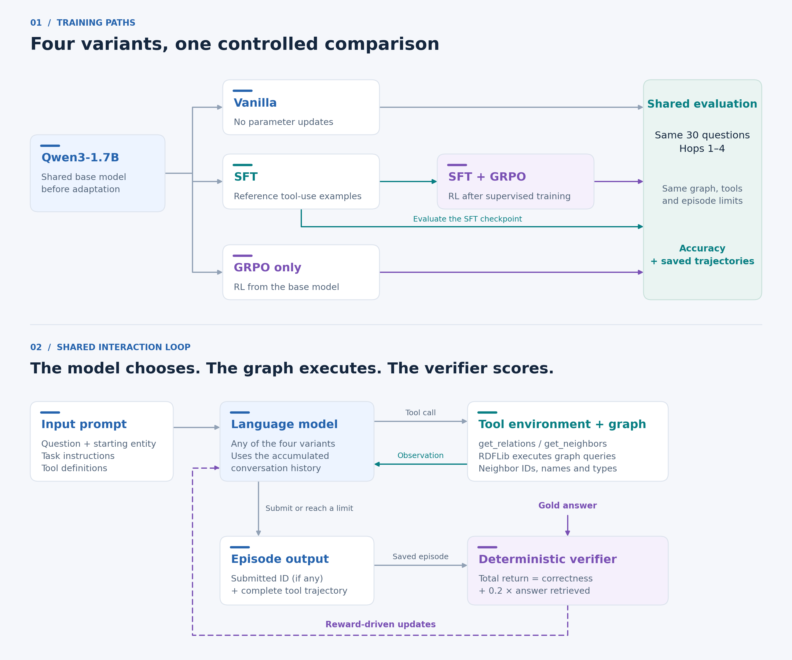

# Knowledge-graph traversal with RLVR

**Teaching language models to reason over structured knowledge through verifiable graph traversal.**
This project provides an end-to-end framework for training and evaluating
language models on multi-hop knowledge-graph question answering with
**reinforcement learning with verifiable rewards (RLVR)**. It brings together an
executable tool environment, deterministic answer verification, supervised and
reinforcement-learning experiments, and detailed trajectory analysis. Reproducible
notebooks compare how demonstrations and reward feedback affect an agent's
ability to explore the graph and submit correct answers.

[Explore the dataset](notebooks/01_dataset_eda.ipynb) ·
[Run the experiment](notebooks/02_grpo_training_kaggle.ipynb) ·
[View results](#results) · [Setup and usage](#setup-and-usage) ·
[Literature review and state of the art](research/README.md)

## Problem formulation

A knowledge graph represents entities, such as researchers and universities, as
nodes connected by named relations. Answering a question often requires following
several relations rather than looking up one fact. The challenge is to translate
the question into the right sequence of relations, choose among intermediate
entities, and recognize when the requested answer has been reached. Graph queries
can execute a known sequence, but the sequence is not provided to the agent here.
We use a language model to interpret the question and choose tool calls, while
RDFLib executes those calls against the graph. The model must learn both where to
explore and when to stop and submit an answer.

### Input and multi-hop traversal

An episode is one attempt to answer a question. It begins with a
**natural-language question and a starting entity ID**, including that entity's
name and type. The agent must return the **single correct answer entity ID**
through `submit_answer`.

**One hop means traversing one graph relation from an entity to a neighbor.**
A multi-hop question requires a sequence of two or more such traversals. For
example, consider this illustrative input with familiar names in a fictional
research graph:

```text
Question: Which country is home to the university where Project Aurora's lead researcher works?
Starting entity: project_000001 (Project Aurora; project)
```

The answer is reached through four graph relations:

```text
Project Aurora
  --led_by--> Dr. Maya Chen
  --works_at--> University of Cambridge
  --located_in_city--> Cambridge
  --city_in_country--> United Kingdom
```

This is a **four-hop question**. Looking up the available relations is a separate
tool call and does not itself traverse an edge. A straightforward solution uses
four relation lookups, four neighbor queries and one submission: nine tool calls.
The chain above explains the example to the reader. The model is not given this
chain or the final answer.

### Actions and observations

An **action** is a tool call selected by the model. An **observation** is the
environment's response to that call, added to the conversation before the model
chooses its next action. For example, a `get_neighbors` observation lists the
neighboring entities returned by the graph, including their IDs, names and types.
This feedback lets the model decide which entity or relation to explore next.
The sequence of actions and observations within an episode is its **trajectory**.
The action–observation loop is illustrated in the lower panel of **Figure 2**.

The system prompt provides task instructions and tool definitions. It does not
include the full graph, ontology or reference path. At the start of an episode,
**only the starting entity may be used as `entity_id` in tool calls**. It counts
as *discovered* immediately. Additional entities become discovered when their IDs
appear in a successful `get_neighbors` response. The agent may then query or
submit those IDs, and they remain available for the rest of the episode. This
lets the agent revisit earlier entities or explore another branch without being
restricted to one current node.

Each assistant turn emits exactly one JSON tool call:

```text
<tool_call>
{"name": "get_relations", "arguments": {"entity_id": "project_000001"}}
</tool_call>
```

| Action | Inputs | Observation |
| --- | --- | --- |
| `get_relations` | Starting or subsequently discovered `entity_id` | Available directed relation IDs |
| `get_neighbors` | Starting or subsequently discovered `entity_id`, plus `relation_id` | Neighbor IDs, names and types |
| `submit_answer` | Starting or subsequently discovered `entity_id` | Submission acknowledgment that ends the episode |

Stored relations have a direction. For example,
`researcher --works_at--> university` supports finding a researcher's university.
Some questions need to follow that same fact in reverse to find researchers at
a given university. For relations that permit this, `get_relations` also exposes
an operation prefixed with `inv:`, such as `inv:works_at`. Calling `get_neighbors` on the university with
that operation returns researchers who work there. This follows existing facts
backward without creating new facts or running an inference engine.

### Verifiable reward and task assumptions

A deterministic verifier compares the episode's submission and tool responses
with the **gold answer (the correct entity ID stored with the question)**:

```python
return_ = float(submitted_answer == gold_answer_id) + 0.2 * answer_retrieved
```

`answer_retrieved` is true if the gold answer appears in a successful, executed
`get_neighbors` response. That retrieval bonus is awarded once per episode.
The total return ranges from **0 to 1.2**. Merely reaching the answer earns at most
0.2, while the correctness reward requires explicitly submitting its ID.
**Test accuracy measures correct submission only.**

The task uses the following assumptions and simplifications:

- **One correct answer:** each question has one answer entity, although several
  graph paths may reach it.
- **A supplied starting point:** the input identifies the starting entity, so the
  agent does not need to resolve a name in the question to a graph ID.
- **A fixed, shared graph:** all variants traverse the same stored facts without
  an inference engine.
- **Different queries over the same graph:** train and test contain different
  underlying graph queries. The experiment evaluates new questions over a known
  graph, rather than transfer to an unseen graph.
- **One wording per underlying query when sampling:** several saved questions
  can express the same query in different words. For example, “Where does
  Dr. Maya Chen work?” and “Which university employs Dr. Maya Chen?” can share
  the same starting researcher, `works_at` relation and answer university.
  Before selecting experiment questions, the code groups records with the same
  starting entity, relation sequence and answer ID, then keeps one representative
  wording from each group. This prevents paraphrases of one query from counting
  as separate training or evaluation examples.

## Saved dataset and ontology

The graph contains **2,000 entities and 5,000 stored facts used for traversal**.
**Figure 1** shows how its **8 entity classes connect through 16 relation types**.
For example, the project-to-researcher, researcher-to-university and
university-to-city links provide the structure needed for the multi-hop example
above. Arrows describe the permitted types of connected entities, rather than
individual facts about named people or places.


*Figure 1. The ontology defines the graph's entity classes and directed relations.
Class counts show how many entities of each type occur in the saved graph.*

The entities comprise 700 researchers, 400 publications, 300 projects, 200 cities,
150 fields, 100 universities, 100 funders and 50 countries. The ontology, labels
and facts are stored together in `data/graph/graph.ttl`, which can be opened in
Protégé and queried through RDFLib. Schema and label triples are excluded from
the 5,000-fact count.

The saved question files contain multiple wordings of some graph queries.
The first row below counts every question record in the JSONL files. The second
counts the distinct underlying queries after retaining one wording per query,
as described in the task assumptions. Both rows cover one- through four-hop
questions.

| What is counted | Train file | Test file |
| --- | ---: | ---: |
| All saved question wordings | 2,449 | 983 |
| Distinct graph queries after grouping paraphrases | 1,226 | 493 |

### Data selected for the recorded experiment

Training uses only **one-, two- and three-hop questions**. This leaves **933
distinct training queries** from the 1,226 available across all four hop counts.
The notebook reserves 100 for SFT, leaving a separate pool of 833 for GRPO.
The table distinguishes these available pools from the examples actually used:

| Phase | Available query pool | Questions or trajectories used | Hop distribution |
| --- | --- | --- | --- |
| SFT | 933 training queries with 1–3 hops, before reservation | 100 question demonstrations, each used for one epoch | 20 one-hop, 40 two-hop, 40 three-hop |
| GRPO only | 833 training queries remaining after SFT reservation | 20 question groups × 8 trajectories = 160 training trajectories | 4 one-hop, 8 two-hop, 8 three-hop groups |
| SFT + GRPO, RL stage | The same 833-query GRPO pool | 20 question groups × 8 trajectories = 160 training trajectories | 4 one-hop, 8 two-hop, 8 three-hop groups |
| Evaluation of every variant | 493 distinct test queries with 1–4 hops | The same fixed sample of 30 questions for each variant | 8 one-hop, 8 two-hop, 7 three-hop, 7 four-hop |

SFT and GRPO use disjoint underlying queries, and the test sample is separate
from both. GRPO samples from its pool during training rather than traversing all
833 queries in the recorded run. Four-hop test questions assess longer chains
than those used for training. Set `TEST_EVAL_SIZE=None` to evaluate all 493
distinct test queries.

## Experiment design

The experiment compares four training paths from the same base model.
**Supervised fine-tuning (SFT)** teaches tool use from executed reference
demonstrations. **GRPO** (Group Relative Policy Optimization) samples several
trajectories for a question and uses their relative rewards to update the policy.
As the upper panel of **Figure 2** shows, GRPO only starts from the base model,
while SFT + GRPO continues from the SFT adapter. The SFT checkpoint is also
evaluated before RL, so its contribution can be assessed separately.
Every variant uses the same prompt, tools, graph, episode limits and test sample.



*Figure 2. Upper panel: the four training paths converge on a shared evaluation.
Lower panel: the input prompt, model, graph tools and verifier form the
interaction and learning pipeline.*

| Variant | Training before evaluation |
| --- | --- |
| Vanilla | None |
| SFT | Supervised learning from reference tool-use trajectories |
| GRPO only | Verifiable-reward training from the base model |
| SFT + GRPO | Supervised learning followed by verifiable-reward training |

In **Figure 2's lower panel**, the model chooses a tool call, the environment
executes it, and the observation returns to the model for its next decision.
When the episode ends, the verifier scores the submitted ID and saved trajectory
against the gold answer. The dashed arrow represents the reward used to train
the GRPO policies.

### Training setup

The recorded experiment uses **Qwen3-1.7B**. The graph environment and verifiers
are separate from the policy model, allowing the approach to be adapted to other
open-weight models with their corresponding chat templates and tool-call formats.

| Training setting | Recorded value |
| --- | --- |
| Model | Qwen3-1.7B, pinned revision |
| Adaptation | NF4 quantization with LoRA rank 8 and alpha 16 |
| SFT | 100 demonstrations, 1 epoch, learning rate `2e-5` |
| Each GRPO variant | 20 optimizer steps, learning rate `5e-6` |
| Generations per question | 8 |
| Gradient accumulation steps / microbatch size | 8 / 1 |
| GRPO question exposure | 20% one-hop, 40% two-hop, 40% three-hop |
| Episode budget, for every variant | 12 tool calls, including submission and invalid calls |

With this configuration, eight trajectories of one question contribute to each
GRPO update. Twenty optimizer steps sample 20 question groups: 4 one-hop,
8 two-hop and 8 three-hop groups. `MAX_TRAIN_EXAMPLES` caps the available question
pool rather than the number of updates. If every trajectory in a group receives
the same reward, its relative advantages are zero, so that group contributes no
reward-driven policy gradient. Training continues with subsequent groups.
The learning rates are example settings rather than tuned optima.

## Results

**Figure 3** compares overall test accuracy and accuracy at each hop count for
all four variants. On the same 30 questions, the saved run reports **4 correct
for vanilla, 16 for SFT, 15 for GRPO only and 20 for SFT + GRPO**. The per-hop
breakdown makes it possible to see whether a gain extends to longer relation
chains, rather than coming only from simpler one-hop questions. Each category
contains 7–8 questions, so these are results of **one seed and a small test sample**.


*Figure 3. Accuracy measures correct answer submission on the shared test sample.
The grouped bars show overall performance and the breakdown by relation-chain length.*

**Figure 4** compares total episodic return during the two GRPO training runs.
It shows the reward received by sampled trajectories as training proceeds,
combining correct submission with the weighted retrieval bonus. This complements
the accuracy comparison in Figure 3: an episode can retrieve the answer and earn
a small reward without successfully submitting it, so return and accuracy measure
different aspects of behavior.


*Figure 4. Mean total return over non-overlapping five-step windows. Shading shows
95% question-cluster bootstrap intervals within the recorded run, not variation
across independently trained seeds. Both result figures are saved outputs from
Notebook 2.*

**SFT + GRPO achieved the highest test accuracy in this run (66.7%), compared with
53.3% for SFT alone, 50.0% for GRPO only, and 13.3% for the vanilla model. Combining
supervised demonstrations with verifiable-reward training produced the best
observed performance on this task. However, evaluation used only 30 questions and
one seed. A larger test set and repeated runs are needed to establish whether this
advantage is consistent.**

## Setup and usage

### Local setup

Install **Git and Python 3.11 or newer**, then run:

```bash
git clone https://github.com/AlirezaAK2000/kg-navigation-rlvr.git
cd kg-navigation-rlvr
python3 -m venv .venv
source .venv/bin/activate
python -m pip install --upgrade pip
python -m pip install -e '.[eda,test]' jupyterlab
python -m ipykernel install --user --name kg-rlvr --display-name "Python (kg-rlvr)"
python -m jupyterlab
```

On Windows, use `python -m venv .venv` and activate it with
`.venv\Scripts\Activate.ps1` in PowerShell. In JupyterLab, select the
**Python (kg-rlvr)** kernel and open `notebooks/01_dataset_eda.ipynb`.
Data exploration needs no GPU or model download.

For local training on **Linux with an NVIDIA CUDA GPU**, install the pinned stack
in the activated environment **before starting JupyterLab**:

```bash
python -m pip install torch==2.6.0 --index-url https://download.pytorch.org/whl/cu124
python -m pip install -r requirements-grpo.txt
```

Then open `notebooks/02_grpo_training_kaggle.ipynb` using the same kernel and keep
`INSTALL_DEPENDENCIES=False`, since the dependencies are already installed.

### Run the training experiment on Kaggle

The complete setup instructions for Kaggle are provided in
[Notebook 2, section 1: Setup](notebooks/02_grpo_training_kaggle.ipynb#setup).
Follow those instructions inside Kaggle before running the experiment cells.
The virtual-environment instructions above apply to your own machine.

1. Open [Notebook 2](notebooks/02_grpo_training_kaggle.ipynb) on Kaggle with
   Internet enabled and a T4 GPU. Only the selected GPU is used.
2. The setup cell clones the repository into `/kaggle/working` without creating
   a repository-named subfolder. Existing project code is reused.
3. In a fresh session, set `INSTALL_DEPENDENCIES=True` and run installation.
   Restart the kernel, set it back to `False`, and run from the top.
4. Use a fresh `RUN_NAME`. Run vanilla evaluation, SFT and its evaluation,
   SFT + GRPO, then the independent GRPO-only variant.
5. Review the saved trajectories and plots. The final ZIP cell packages results,
   slide figures and adapters. Full optimizer checkpoints remain separate.

Pinned training dependencies are in [requirements-grpo.txt](requirements-grpo.txt).
The recorded run uses random seed 41 for reproducibility. The training notebook
preserves that run's figures, and the documentation refactor has not performed a
new pretrained GPU run.

### Inspect the data locally

After completing project setup, run these commands from the repository root:

```bash
python scripts/run_eda_notebook.py
python -m pytest -q
```

[Notebook 1](notebooks/01_dataset_eda.ipynb) exports ontology, composition, question
coverage and traversal-budget figures in PNG, SVG and PDF under `artifacts/eda/`.
It reads the saved data without modifying it and requires no model download.

## Use your own graph

Replace `DATA_ROOT` with a dataset following the saved Turtle and JSONL formats.
Turtle must provide entity IDs, labels, types, and relation domain/range and inverse
metadata. Each QA record provides question text, a starting entity, one
`answer_id`, hop count, relation program and witness paths. A witness path is a
recorded sequence of entities that reaches the answer through those relations.
These paths provide SFT demonstrations. Only the question and starting entity
enter model prompts. Question wording is stored directly in the train/test JSONL
files.

The main files to adapt are:

- [data.py](src/kg_rlvr/data.py): saved questions, prompts and selection.
- [environment.py](src/kg_rlvr/training/environment.py): tool behavior and budgets.
- [rewards.py](src/kg_rlvr/training/rewards.py): verifiers and TRL reward functions.
- [sft.py](src/kg_rlvr/training/sft.py): reference demonstrations and assistant labels.
- [rollouts.py](src/kg_rlvr/training/rollouts.py): multi-turn generation and token masks.
- [grpo.py](src/kg_rlvr/training/grpo.py): model loading and TRL configuration.

The rollout codec targets Qwen3's chat template. Adapting another model requires
matching its tool-call format and observation-token masking. Update the ontology
figure's layout when using different entity classes.
