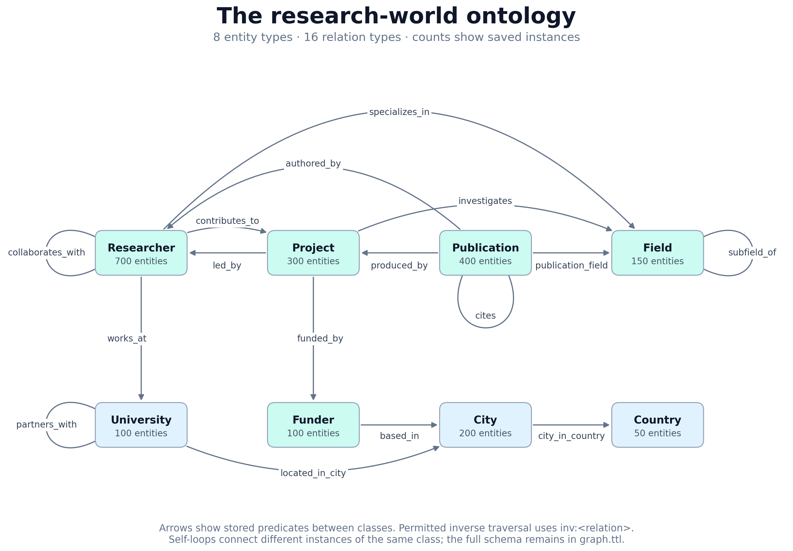
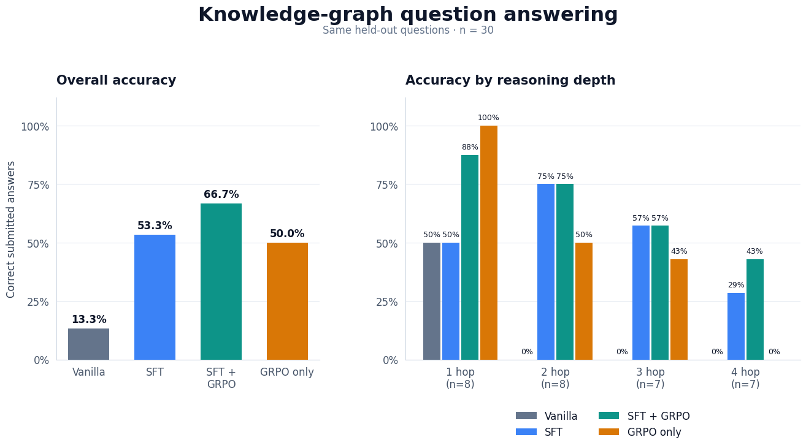
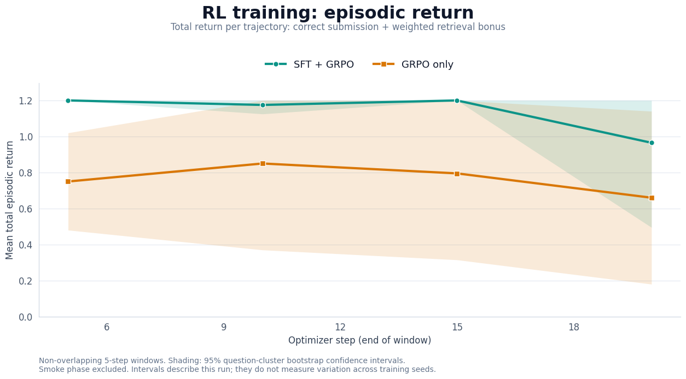

# Knowledge-graph navigation with RLVR

A practical tutorial on training **Qwen3-1.7B** to navigate a knowledge graph using
**reinforcement learning with verifiable rewards (RLVR)**. Compare vanilla, SFT,
GRPO only, and SFT + GRPO using the same test questions and tool environment.

## Project setup

Install **Git and Python 3.11 or newer**, then run:

```bash
git clone https://github.com/AlirezaAK2000/kg-navigation-rlvr.git
cd kg-navigation-rlvr
python3 -m venv .venv
source .venv/bin/activate
python -m pip install --upgrade pip
python -m pip install -e '.[eda,test]' jupyterlab
python -m ipykernel install --user --name kg-rlvr --display-name "Python (kg-rlvr)"
python -m jupyterlab
```

On Windows, use `python -m venv .venv` and activate it with
`.venv\Scripts\Activate.ps1` in PowerShell. In JupyterLab, select the
**Python (kg-rlvr)** kernel and open `notebooks/01_dataset_eda.ipynb`.
Data exploration needs no GPU or model download.

For **Kaggle training**, the complete setup instructions are provided in
[Notebook 2, section 1: Setup](notebooks/02_grpo_training_kaggle.ipynb#setup).
Follow that section inside Kaggle; the local virtual-environment instructions
above are for running the project on your own machine.

For local training on **Linux with an NVIDIA CUDA GPU**, install the pinned stack in the activated
environment **before starting JupyterLab**:

```bash
python -m pip install torch==2.6.0 --index-url https://download.pytorch.org/whl/cu124
python -m pip install -r requirements-grpo.txt
```

Then open `notebooks/02_grpo_training_kaggle.ipynb` using the same kernel and keep
`INSTALL_DEPENDENCIES=False`, since the dependencies are already installed.

## Problem formulation

Given a natural-language question and a **starting entity ID**, the agent must
navigate the graph and **submit the single correct entity**. Each episode starts
with only that entity discovered. The observation history supplies the agent's
state; the graph and private gold answers are held by Python.

Example model input:

```text
Question: Which city hosts the university where Dr. Kyrkyrthae 0515 works?
Starting entity: researcher_000514 (Dr. Kyrkyrthae 0515; researcher)
```

The system prompt describes the task and tools. It contains no gold entity,
reference path, or full ontology. Each assistant turn emits one JSON tool call:

```text
<tool_call>
{"name": "get_relations", "arguments": {"entity_id": "researcher_000514"}}
</tool_call>
```

| Action | Inputs | Observation |
| --- | --- | --- |
| `get_relations` | Discovered `entity_id` | Available directed relation IDs |
| `get_neighbors` | Discovered `entity_id`, `relation_id` | Neighbor IDs, names and types |
| `submit_answer` | Discovered `entity_id` | Submission acknowledgment; ends the episode |

Successful neighbor queries expand the discovered set. `inv:` identifies permitted
inverse traversal. Invalid calls return errors and consume the call budget.
Defaults allow 12 calls, 128 generated tokens per turn, and a 3,072-token context.
Only asserted graph facts are traversed; no reasoner runs during an episode.

The deterministic verifier scores the complete episode:

```python
return_ = float(submitted_answer == gold_answer_id) + 0.2 * answer_retrieved
```

`answer_retrieved` is true when a successful executed neighbor response contains
the gold entity. This bonus is awarded once. Returns range from 0 to 1.2; **test
accuracy measures correct submission only**. Finding an answer without submitting
it earns at most 0.2. Gold answers and reward feedback stay outside tool observations.

Every saved question has one correct answer, stored as `answer_id`. Paraphrases
of the same query instance are merged. Train and test share the graph, but query
instances are separated.
SFT and GRPO reserve different training instances; test questions never enter the
optimizer. One answer can still be reachable through multiple graph branches.

## Saved dataset and ontology



The diagram shows all 8 entity classes and 16 stored relation types. The ontology,
entity labels and facts are together in `data/graph/graph.ttl`, which can be opened
in Protégé. RDFLib provides navigation. Graph and ontology generators are not part
of this tutorial.

| Statistic | Train | Test |
| --- | ---: | ---: |
| Saved question rows | 2,449 | 983 |
| Unique query instances, hops 1–4 | 1,226 | 493 |

The graph contains **2,000 entities and 5,000 stored navigation facts**. Its entities
are 700 researchers, 400 publications, 300 projects, 200 cities, 150 fields,
100 universities, 100 funders and 50 countries. Schema and label triples are not
included in the 5,000-fact count.

Training uses hops 1–3: 933 instances are available before reserving SFT data.
The recorded configuration reserves **100 SFT instances**, leaving **833 for GRPO**.
All four models use the same 30 test questions across hops 1–4. Set
`TEST_EVAL_SIZE=None` to evaluate all 493 unique test instances.

## Reproduce the experiment

The Kaggle environment and dependency setup are documented in
[the training notebook's Setup section](notebooks/02_grpo_training_kaggle.ipynb#setup).
Complete that section before running the experiment cells.

1. Open [the training notebook](notebooks/02_grpo_training_kaggle.ipynb) on Kaggle
   with Internet enabled and a T4 GPU. Only the selected GPU is used.
2. Setup clones the repository into `/kaggle/working` without creating a
   repository-named subfolder. Existing project code is reused.
3. In a fresh session, set `INSTALL_DEPENDENCIES=True` and run installation.
   Restart the kernel, set it back to `False`, and run from the top.
4. Use a fresh `RUN_NAME`. Run vanilla evaluation, SFT and its evaluation,
   SFT + GRPO, then the independent GRPO-only variant.
5. Review the saved trajectories and plots. The final ZIP cell packages results,
   slide figures and adapters. Full optimizer checkpoints remain separate.

Pinned training dependencies are in [requirements-grpo.txt](requirements-grpo.txt).
The notebook preserves the recorded experiment's figures; the refactor has not
performed a new pretrained GPU run.

| Setting | Recorded value |
| --- | --- |
| Model | Qwen3-1.7B, pinned revision |
| Adaptation | NF4 quantization; LoRA rank 8, alpha 16 |
| SFT | 100 demonstrations, 1 epoch, learning rate `2e-5` |
| Each GRPO variant | 20 optimizer steps, learning rate `5e-6` |
| Generations / gradient accumulation / microbatch | 8 / 8 / 1 |
| GRPO question exposure | 20% one-hop, 40% two-hop, 40% three-hop |
| Seed | 41 |

Eight trajectories of one question contribute to each GRPO update. Twenty steps
sample 20 question groups, with 4/8/8 groups across the training hops.
`MAX_TRAIN_EXAMPLES` caps the available question pool; it does not set the number
of updates. Identical rewards within a group give zero relative advantages and do
not stop training. Learning rates are example settings, not tuned optima.

## Results

The saved run reports 4/30 correct for vanilla, 16/30 for SFT, 15/30 for GRPO only,
and 20/30 for SFT + GRPO. These are results of **one seed and 30 questions**.



All variants answer the same test questions, with 7–8 questions per hop category.



Returns combine correctness and the weighted retrieval bonus, averaged over
non-overlapping five-step windows. Shading shows 95% question-cluster bootstrap
intervals within this run; it does not measure variation across training seeds.
Both figures are the saved outputs from the end of Notebook 2.

**SFT + GRPO achieved the highest test accuracy in this run (66.7%), compared with
53.3% for SFT alone, 50.0% for GRPO only, and 13.3% for the vanilla model. Combining
supervised demonstrations with verifiable-reward training produced the best
observed performance on this task. However, evaluation used only 30 questions and
one seed; a larger test set and repeated runs are needed to establish whether this
advantage is consistent.**

## Inspect the data locally

After completing project setup, run these commands from the repository root:

```bash
python scripts/run_eda_notebook.py
python -m pytest -q
```

[Notebook 1](notebooks/01_dataset_eda.ipynb) exports ontology, composition, question
coverage and navigation-budget figures in PNG, SVG and PDF under `artifacts/eda/`.
It reads the saved data without modifying it and requires no model download.

## Use your own graph

Replace `DATA_ROOT` with a dataset following the saved Turtle and JSONL formats.
Turtle must provide entity IDs, labels, types, and relation domain/range and inverse
metadata. Each QA record provides question text, a starting entity, one
`answer_id`, hop count,
relation program and witness paths. Witness paths are used for SFT demonstrations;
only the question and starting entity enter model prompts. Question wording is
stored directly in the train/test JSONL files.

The main files to adapt are:

- [data.py](src/kg_rlvr/data.py): saved questions, prompts and selection.
- [environment.py](src/kg_rlvr/training/environment.py): tool behavior and budgets.
- [rewards.py](src/kg_rlvr/training/rewards.py): verifiers and TRL reward functions.
- [sft.py](src/kg_rlvr/training/sft.py): reference demonstrations and assistant labels.
- [rollouts.py](src/kg_rlvr/training/rollouts.py): multi-turn generation and token masks.
- [grpo.py](src/kg_rlvr/training/grpo.py): model loading and TRL configuration.

The rollout codec targets Qwen3's chat template. Adapting another model requires
matching its tool-call format and observation-token masking. Update the ontology
figure's layout when using different entity classes.
